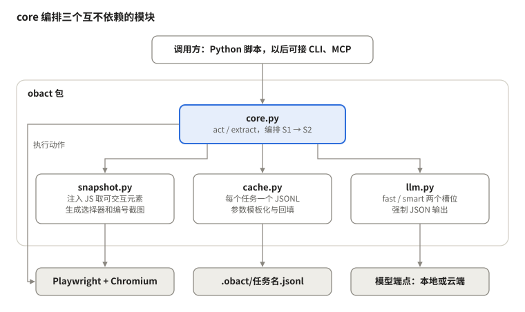
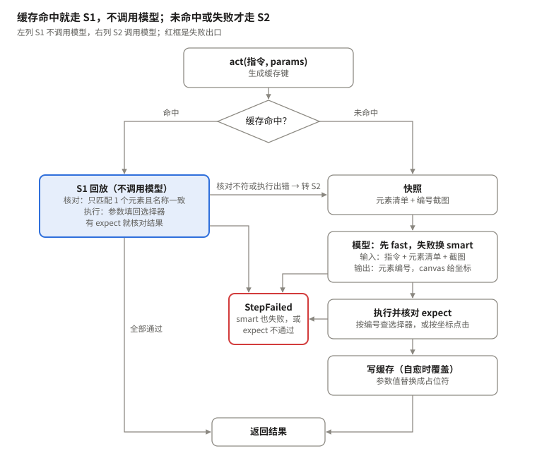
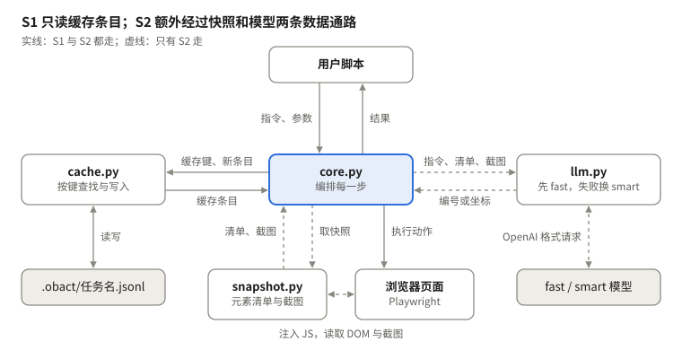
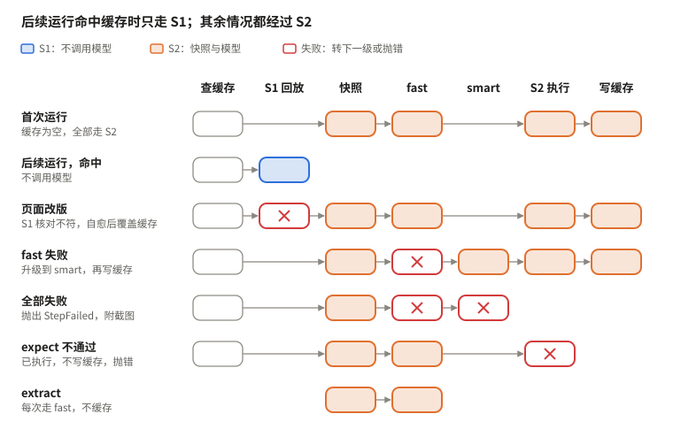

# Obact 设计文档

2026-10-27

## 概述

Obact 是一个单任务网页自动化工具：第一次运行由视觉模型识别和定位（S2），跑通后缓存定位结果，之后的运行直接按缓存执行（S1），不调用模型。

- **S2 推理路径**：缓存未命中或 S1 失败时触发。先取页面快照（元素清单 + 编号截图）交给 fast 模型，失败再交给 smart 模型。普通页面返回元素编号，canvas 返回坐标。执行成功后写入缓存。
- **S1 直觉路径**：缓存命中时触发。核对选择器只匹配到一个元素且名称一致，然后直接执行。
- **首次与后续运行**：首次运行缓存为空，全部走 S2；后续运行大部分步骤走 S1，只有未命中、页面变化和 extract 走 S2。两者是同一条代码路径。

**范围**

- Python 实现，执行层用 Playwright。
- 两个模型槽位 fast 和 smart，都必须支持视觉；每个槽位由用户配置为本地或云端的 OpenAI 格式接口。
- 不做跨任务记忆和学习，缓存只服务于同一任务的重复运行。

**暂不做**（需要时再加）：自动生成执行后校验、缓存提取规则、多候选选择器、iframe 与 shadow DOM 的特殊处理、视觉模板匹配、运行模式、验证码自动检测。

## 架构设计图



core 是唯一的编排者：snapshot、cache、llm 互不引用，可以单独测试或替换；浏览器只由 core（执行动作）和 snapshot（读取页面）访问。

## 接口与配置

脚本是任务的源头：每一步写一句自然语言指令，参数用 `{名称}` 占位。需要按页面数据做判断的步骤（如选最便宜的航班），用 extract 取数据、代码做判断、再用参数化的 act 执行，这样这一步也能走 S1。

```python
from obact import Obact

async with Obact(task="flight", config="obact.yaml") as ob:
    await ob.page.goto("https://flights.example.com")
    await ob.act("在出发地输入 {city}", params={"city": "上海"})
    await ob.act("在出发日期输入 {date}", params={"date": "2026-11-15"})
    await ob.act("点击搜索", expect="text=航班列表")
    flights = await ob.extract("所有航班的航班号和价格", schema=list[Flight])
    cheapest = min(flights, key=lambda f: f.price)   # 判断交给代码
    await ob.act("点击航班 {flight_no} 的预订按钮", params={"flight_no": cheapest.flight_no})
```

| 接口 | 作用 | 是否缓存 |
| --- | --- | --- |
| `act(instruction, params=None, step=None, expect=None)` | 执行一步操作 | 是 |
| `extract(instruction, schema)` | 按 schema 提取数据 | 否，每次走 fast 模型 |
| `wait_for_human(message)` | 暂停，等人工完成验证后继续 | — |

- `step`：可选的步骤名。同一页面上出现两句相同的指令时，用它区分缓存。
- `expect`：可选的执行后校验，填一个选择器（元素应可见）或 URL 模式。
- 每步打印一行日志：走了 S1、fast 还是 smart，命中、未命中还是自愈。

配置文件 `obact.yaml`：

```yaml
viewport: {width: 1280, height: 800}   # 固定视口，保证 canvas 坐标可以复用
cache_dir: .obact
models:                                # 两个槽位都必须支持图像输入
  fast:  {base_url: http://localhost:8000/v1, model: <视觉小模型>,   api_key_env: OBACT_FAST_KEY}
  smart: {base_url: <本地或云端地址>,         model: <高级视觉模型>, api_key_env: OBACT_SMART_KEY}
```

启动时向两个模型各发一张很小的测试图，不支持视觉就直接报错。密钥从环境变量读取，不写进配置文件。

## act() 总流程



首次运行时缓存为空，每一步都从右列开始；之后命中的步骤只走左列。S1 核对不符或执行出错时转 S2 自愈；动作已执行但 expect 不通过时直接抛错，不再升级。

## 数据流



S1 只用到实线：读缓存条目、填回参数、执行动作。各项数据的内容：

| 数据 | 内容 |
| --- | --- |
| 缓存键 | `step` 或指令模板，加上 URL 的域名和路径 |
| 缓存条目 | selector 或 point、name、method、args |
| 元素清单 | 编号、标签、role、名称、当前值、位置；另存一张“编号 → 选择器”对照表 |
| 编号截图 | 视口截图，可交互元素画上编号框 |
| 模型输出 | 元素编号或坐标、method、args；找不到时返回 `found: false` |

## 各情况运行流程



每一行是一种情况下一步操作实际经过的环节。canvas 的路径与首次运行相同，只是模型返回坐标、缓存存 point，后续运行按坐标走 S1。`wait_for_human` 不在这条链上：脚本主动调用时暂停，人工完成验证后从下一步继续。

## 缓存格式

每个任务一个文件 `.obact/<task>.jsonl`，每行一个步骤条目，只存回放必需的字段；版本历史交给 git。

```json
{"key": "点击航班 {flight_no} 的预订按钮|flights.example.com/search",
 "selector": "xpath=//tr[.//td[text()='{flight_no}']]//button",
 "name": "预订", "method": "click", "args": []}
```

canvas 条目把 `selector` 换成相对视口的比例坐标：

```json
{"key": "点击图表右上角的放大按钮|charts.example.com/view",
 "point": [0.63, 0.28], "method": "click", "args": []}
```

| 字段 | 含义 |
| --- | --- |
| `key` | `step` 或指令模板，加上 URL 的域名和路径（去掉查询串，纯数字路径段换成 `*`） |
| `selector` | 蒸馏器生成的稳定选择器，参数值已替换成 `{参数名}` |
| `name` | 目标元素的可访问名称，S1 执行前用来核对 |
| `point` | canvas 目标的坐标，取值 0–1，相对固定视口 |
| `method` / `args` | 动作及其参数，如 `click`、`fill`；`args` 里也可以含 `{参数名}` |

**参数模板化**：写入缓存时，参数值如果原样出现在 selector 或 args 里，就替换成 `{参数名}`，回放时再填回。参数值在页面上经过了转换（例如日历只显示“15”）时无法模板化，这一步每次走 S2。

想重新学习整个任务时，删掉这个文件即可。

## 错误处理

动作执行之前的失败自动升级到下一级；动作已经执行、但结果不对时直接停下，不盲目重试。

| 情况 | 处理 |
| --- | --- |
| S1 选择器匹配到 0 个或多个元素，或名称不一致 | 不执行，转 S2 |
| S1 执行时报错或超时（如元素不可点击） | 转 S2 |
| 模型返回的 JSON 不合法 | 同一模型重试 1 次，仍失败则升级 |
| 模型接口超时或网络错误 | 重试 1 次，仍失败则升级 |
| fast 返回“找不到”，或它给出的目标执行出错 | 升级到 smart |
| smart 也失败 | 抛出 `StepFailed`，附截图和各级尝试记录 |
| 动作已执行，但 `expect` 不通过 | 不写缓存，抛出 `StepFailed`，附截图 |
| 缓存文件中有损坏的行 | 跳过该行并警告，这一步按未命中处理 |

S2 成功后覆盖旧条目，日志记为“自愈”，不需要人工确认。

## 测试

用一个本地测试页和一个假模型，验证主线：第一遍全部走 S2，第二遍全部走 S1。

- **单元测试**：缓存键生成；参数模板化与回填；JSONL 读写（含损坏行）；模型输出解析（合法、非法、找不到）。
- **假模型**：按预设返回元素编号或坐标，流程测试不依赖真实模型。
- **本地测试页**：覆盖普通表单、列表、弹窗遮挡、首屏以下的元素和 canvas。
- **两遍运行**：第一遍断言每步都走 S2 并写入缓存；第二遍断言模型调用次数为 0。
- **自愈**：改掉测试页的按钮文案或结构后再跑，断言这一步走 S2、缓存被覆盖，其余步骤仍走 S1。
- **升级与失败**：让假 fast 返回“找不到”，断言升级到 smart；两者都失败时断言抛出 `StepFailed`。
- **expect**：让动作执行后的结果与 `expect` 不符，断言不写缓存并抛错。
