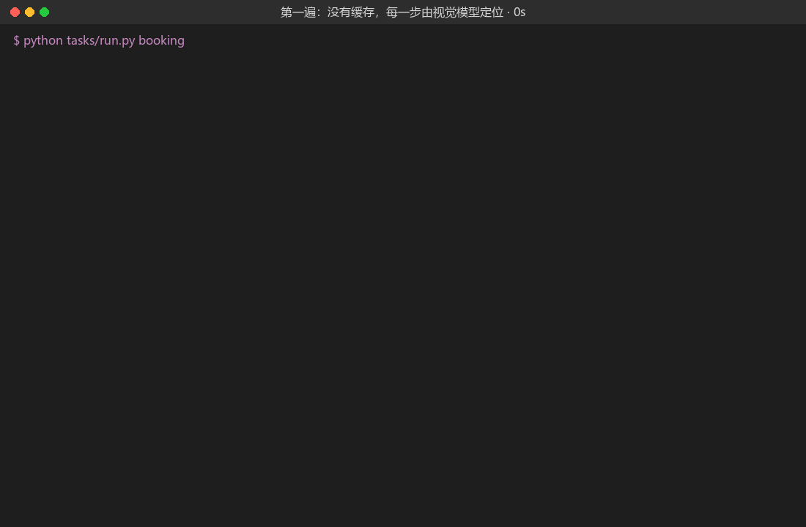
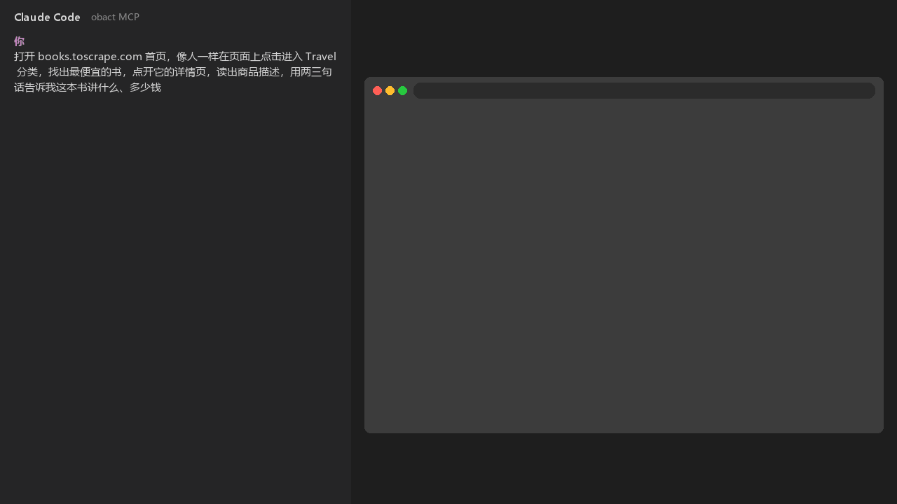
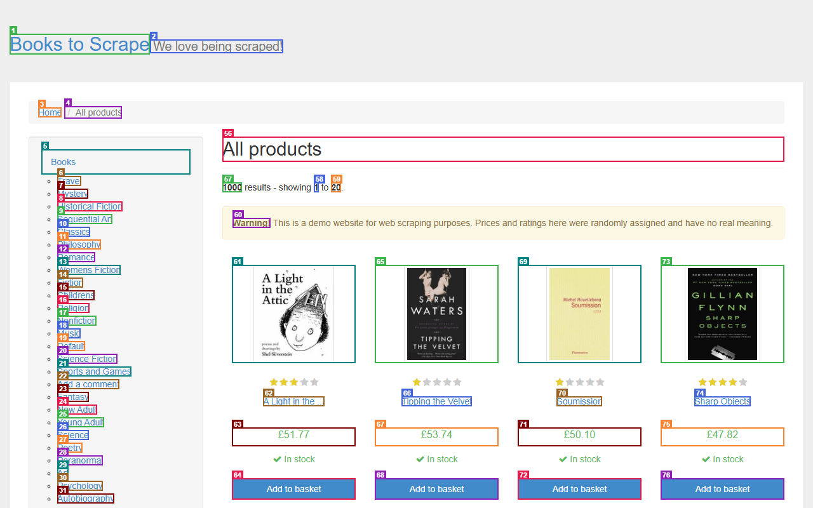
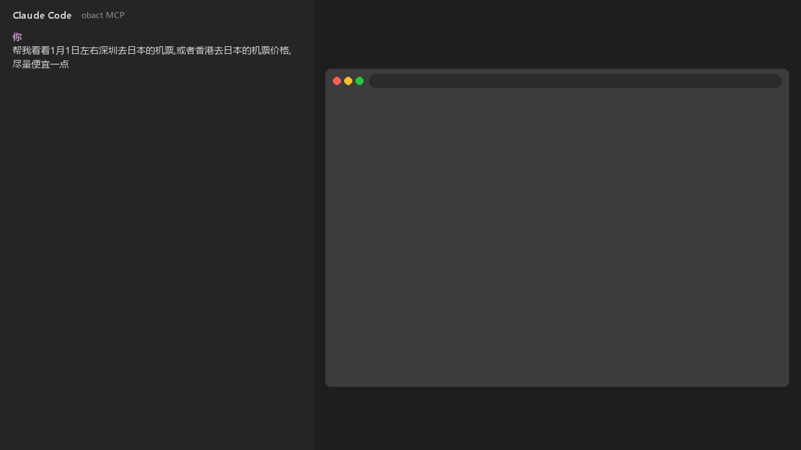

# Obact

English | [简体中文](README.zh-CN.md)

Describe each step on a web page in one sentence. The first time, a vision model looks at the page, finds the target and performs the action; on success, the location is recorded. The next time you do the same thing, Obact executes from the record without calling the model. When the page changes and the record no longer matches, it falls back to the model, finds the target again and updates the record.

- Learn once, then no more model calls: for repeated flows, from the second run on the speed is on par with a regular automation script.
- Reusable with different parameters: values that change (city, product name, flight number) are written as {placeholders}; with other values the record still replays.
- Self-healing: when a record doesn't match the page, Obact relocates the target automatically, with no manual maintenance.
- Two ways to run: in MCP mode, you tell the AI in Claude Code what to do in natural language and it operates the browser, no code needed; in Workflow mode, you write the flow as a Python script that runs fixed steps.
- Bring your own model: any OpenAI-compatible model with image input, local or cloud.



The animation above is the real terminal output of running tasks/booking.py (search and book the cheapest flight on blazedemo.com) twice, with the time spent waiting for the model compressed:

| | Hand-written Playwright script | Agent that asks the model at every step | Obact |
| --- | --- | --- | --- |
| Writing | You find the selectors yourself | One sentence | One sentence |
| Cost and speed of repeated runs | No model calls, fast | Model call per step, slow and expensive | Model calls on the first run, then same as a script |
| After a page redesign | Selectors break, fix by hand | Adapts | Relocates automatically, updates the cache |
| Reproducible results | Yes | Path may differ each run | Yes, the cache is readable JSONL |

## Two ways to run

| | MCP mode | Workflow mode |
| --- | --- | --- |
| For | Users who don't write code | Programmers, further development |
| How | Tell Claude Code what you want in plain language; Claude calls Obact to operate the browser | Write a Python script and run it with python |
| Who decides the next step | Claude, after looking at the page each step; Obact executes and caches | The steps written in the script, in order |
| Good for | Exploratory or one-off tasks, when you don't want to write code | Fixed flows you run again and again |
| Install | uv tool install, then connect with claude mcp add | pip install in the project's virtual environment |
| Cache (step record) hits | Only when the wording matches a recorded step; when Claude looks at a page it sees the steps already recorded for it and reuses them as is | Whenever the instruction text is unchanged; from the second run on, act, read and download don't call the model |

Both modes need a .env file in the folder you work in, containing the model's API address, model name and key.

## MCP mode: use it in Claude Code (no code needed)

Claude Code is a tool for chatting with an AI in the terminal and having it do work for you. MCP is how it connects to external tools: once Obact is connected, Claude can open a browser, look at pages, click and type, read text, and save results to files. You just say what you want done.

### Preparation

1. [Claude Code](https://code.claude.com/docs), already installed.
2. Three pieces of information for a model with image input (get them from your model provider): API address (usually ending in /v1), model name, and key. Any OpenAI-compatible API works, local or cloud.
3. A folder dedicated to Obact's records and output files, called "your folder" below.

There are two ways to install; pick one: let Claude install it for you, or run the commands in a terminal yourself.

### Let Claude install it

Open Claude Code in the folder where you want to use Obact and send it the following text as is:

```
Please install and configure the Obact browser automation tool (https://github.com/ZoraMing/obact):
1. If uv is not installed yet, install it using the official method at https://docs.astral.sh/uv/.
2. Run uv tool install https://github.com/ZoraMing/obact/archive/refs/heads/master.zip
3. Run uvx playwright==1.58.0 install chromium to install the browser.
4. Create a .env file in the current folder, ask me for the model's API address, model name and key, and write them as three lines: MODEL_BASE_URL, MODEL_NAME, MODEL_KEY. If there is a .gitignore, add .env and .obact to it.
5. Run claude mcp add obact -- obact-mcp
When done, tell me whether I need to restart Claude Code or reconnect in /mcp.
```

### Install it yourself

Run the following in a terminal, in order (PowerShell on Windows):

```powershell
# 1. Install uv (a Python tool manager that sets up Python for you); on macOS and Linux use curl -LsSf https://astral.sh/uv/install.sh | sh
powershell -ExecutionPolicy ByPass -c "irm https://astral.sh/uv/install.ps1 | iex"

# 2. Close and reopen the terminal, then install Obact and the browser it uses
uv tool install https://github.com/ZoraMing/obact/archive/refs/heads/master.zip
uvx playwright==1.58.0 install chromium

# 3. Go to the folder you want to use and connect Obact to Claude Code
cd your-folder
claude mcp add obact -- obact-mcp
```

Then create a text file named .env in this folder with:

```
MODEL_BASE_URL = model API address
MODEL_NAME = model name
MODEL_KEY = your key
```

When saving with Notepad, set "Save as type" to "All files", otherwise the file becomes .env.txt. Replace the right side of each equals sign with your own value; no quotes needed.

### Check the connection

Start Claude Code in your folder and type /mcp. If obact appears in the list, it is connected. If it doesn't, make sure you ran claude mcp add in your folder, then restart Claude Code.

### Get started

Start Claude Code in this folder and say what you want done. Be clear about which website to open, what to do, and what form the result should take (tell you directly, or save as a table). For example:

- Open the books.toscrape.com home page, click into the Travel category like a person would, find the cheapest book, open its detail page, read the product description, and tell me in two or three sentences what the book is about and how much it costs
- Open blazedemo.com, look up flights from Boston to London, and save the flight list as a table
- Check flight prices from Shenzhen to Japan, or from Hong Kong to Japan, around January 1, as cheap as possible

The animation below shows Claude Code actually completing the first example (compiled from the real output of claude -p, Claude Code's non-interactive mode; it took 79 seconds, with the footage compressed):



The first time Claude operates the browser, a browser window pops up and you can watch it work. This browser is opened by Obact on its own and is separate from the browser you normally use: it has none of your bookmarks or logged-in accounts. When Claude looks at a page, it gets an element list and a screenshot with numbered boxes like the one below, then picks the element to act on. Successful steps are recorded in the .obact folder inside your folder, so doing the same thing next time is faster; saved files such as tables also go in your folder.



### Example: searching for flights

The animation below shows the third example in action (compiled from the real output of claude -p and browser screenshots of each step; it took about 4 minutes, with the footage compressed). On Google Flights, Claude searched one-way tickets from Shenzhen and Hong Kong to Tokyo and Osaka, then checked prices from Hong Kong for December 31 to January 2, and finally summarized them into a comparison and recommendation. The fares are the results on the day of recording and change over time.



### FAQ

| Situation | What to do |
| --- | --- |
| No .env, or an entry is missing | The first browser operation reports an error; Claude tells you where it looked for .env and gives a configuration template. Fill it in accordingly |
| Changes to .env don't take effect | Type /mcp in Claude Code and reconnect obact |
| The website requires logging in to an account, or shows a CAPTCHA | Claude asks you to log in or complete the check by hand in the browser window Obact opened; tell it to continue when you're done |
| The browser window was closed | It reopens automatically on the next operation; pages that were open before need to be opened again |
| Logged in to a website once and don't want to log in again next time | See "Keep website login state" below |
| Don't want to see the browser window | Add the line OBACT_HEADLESS = true to .env; the browser then runs in the background. You can't log in or solve CAPTCHAs by hand in this mode, so remove the line when you need to |
| The model often can't find what to click | By default Obact uses the model in .env (the fast model); when it can't find the target, it can switch to a stronger backup model (the smart model). Add SMART_MODEL_BASE_URL, SMART_MODEL_NAME and SMART_MODEL_KEY to .env; if it's from the same provider as the model above, SMART_MODEL_NAME alone is enough, since entries you leave out use the settings above |
| Update Obact | Run the uv tool install command from step 2 again with --reinstall, then reconnect in /mcp |

### Keep website login state

"Logging in" here means logging in to the websites you have Claude operate, such as accounts on shopping sites, forums or admin back-ends. By default, Obact starts the browser with a fresh temporary directory every time; when the browser closes, the websites' login state (cookies) is lost, and you have to log in again next time.

To keep the login state, add this line to .env:

```
OBACT_USER_DATA_DIR = workspace/profiles/default
```

The right side is a folder path where the browser stores cookies, login state and other data, and picks them up again next time. You can choose the path yourself; a relative path starts from your folder, so the line above means workspace/profiles/default inside your folder. After editing .env, reconnect obact in /mcp, then log in once by hand in the browser Obact opens; after that you don't need to log in again (unless the website expires the login itself).

Note:

- This folder holds your login information. Don't send it to others or upload it anywhere.
- Only one Claude Code session can use this folder at a time; with two sessions open, the one that opens its browser second fails.

For the tool list, cache rules, startup options and configuration for other MCP clients, see [MCP service](docs/mcp.md) (Chinese).

## Workflow mode: write a Python script

Requires Python 3.11 or later. Install in the project's virtual environment and put a .env in the project root (same as above; full configuration in the [User guide](docs/guide.md#配置), Chinese):

```powershell
pip install https://github.com/ZoraMing/obact/archive/refs/heads/master.zip   # for further development use pip install -e path-to-source
playwright install chromium
```

```python
import asyncio
from pydantic import BaseModel
from obact import Obact


class Book(BaseModel):
    title: str
    price: float


async def main():
    async with Obact(task="books") as ob:                           # cache is written to .obact/books/steps.jsonl
        await ob.goto("https://books.toscrape.com/")
        await ob.act("Click {category} in the category list on the left", params={"category": "Travel"},
                     expect="**/category/books/**")
        books = await ob.extract("Titles and prices of all books on the page", schema=list[Book])
        cheapest = min(books, key=lambda b: b.price)                 # decisions are left to code
        await ob.act("Click the link whose title is {title}", params={"title": cheapest.title})
        description = await ob.read("The product description paragraph under the Product Description heading")
        ob.save(books, "books.csv")


asyncio.run(main())
```

Run python books.py twice in a row: on the first run the log says "fast 视觉模型执行（无缓存）" (executed by the fast vision model, no cache), on the second it becomes "S1 命中缓存，直接回放" (S1 cache hit, replayed directly). extract calls the model every time, and so do steps whose log shows "参数无法模板化，不缓存" (parameter can't be templated, not cached); see the [User guide](docs/guide.md#写指令的要点) (Chinese) for how to write them. The interfaces are listed in the table below; module layout and implementation details are in [Architecture](docs/architecture.md) (Chinese).

## Interfaces

| Interface | Purpose | Cache |
| --- | --- | --- |
| act | Click, hover, type, press keys, select from dropdowns | Caches the target location |
| read | Read all text in an area of the page (body text, table, list) | Caches the area location |
| download | Click to trigger a download and save the file | Caches the click location |
| upload | Click the upload button and choose local files in the file dialog | Caches the click location |
| extract | Extract structured data according to a pydantic schema | Not cached, calls the model every time |
| save | Write results as JSON, CSV, Markdown or TXT files | — |
| scroll | Scroll down one screen so lazy-loaded or infinite-scroll content appears | No model call |
| wait_for | Wait for a URL match, an element to appear, or a fixed amount of time | No model call |
| wait_for_human | Pause until a person completes a CAPTCHA, login, etc. | — |

Parameters, expect checks, log meanings, failure handling and cache format are in the [User guide](docs/guide.md) (Chinese).

## How it works


1. Each step gets a cache key: the instruction template (or step) plus the page's domain and path.
2. On a cache hit (S1): check that the selector matches exactly one element and that its name matches the cache, then execute directly.
3. On a miss or a failed check (S2): take the element list and a numbered screenshot and give them to the fast model, which picks a number; if that fails, hand it to the smart model.
4. Post-execution check: if expect is given, wait for it; otherwise check whether the page changed. The cache is written only if this passes.
5. When writing the cache, parameter values are turned back into {placeholders}, producing a selector that can be replayed with other parameters:

```json
{"key": "Click the Choose This Flight button in the row whose flight number is {flight}|blazedemo.com/reserve.php",
 "selector": "xpath=//tr[.//text()[normalize-space(.)='{flight}']]//input[@type='submit']",
 "name": "Choose This Flight", "method": "click", "args": []}
```

See [Architecture](docs/architecture.md) (Chinese) for the detailed design. Element collection, selector generation, page settle waiting and anti-automation detection draw on [Stagehand](https://github.com/browserbase/stagehand).

## More

All documents below are in Chinese.

| Document | Contents |
| --- | --- |
| [User guide](docs/guide.md) | Configuration, interface parameters, tips for writing instructions, expect, logs, failure handling, cache, current limitations |
| [MCP service](docs/mcp.md) | Tool list, cache hits, executing by number, deployment, running and shutdown |
| [Architecture](docs/architecture.md) | Module layout, the flow of one step, snapshots, selectors, parameter templating, page settle waiting, model calls |
| [Examples and task set](tasks/README.md) | Example scripts in examples/, five OSWorld-style real-site tasks |
| [Testing](docs/testing.md) | Smoke test and three levels of pytest |
| [Design document](docs/Obact_PRD_v2.md) | Requirements and design rationale |
